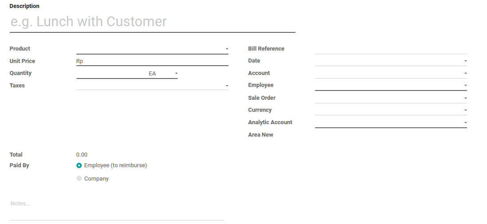

    
#  Alur Pembuatan Expenses

Halaman ini menjelaskan langkah-langkah standar untuk membuat dokumen *Expenses* (Pembayaran) hingga menjadi *Payment* yang siap diproses oleh tim kasir.

## 1. Membuat Expenses Baru

1. Masuk ke modul **Expenses** > **Control** > **Vendor Bills**.
2. Klik tombol **Create** di pojok kiri atas halaman. Atau pilih *Vendor Bill* yang  sudah terbentuk dari *PO*.
3. Isi keterangan biaya expenses pada kolom **Description**.
4. Pilih tipe biaya expenses pada kolom **Product**. 
5. Isi nominal biaya pada kolom **Unit Price**, jumlahnya pada kolom **Quantity**, dan jika ada pajak pilih tipe pajak nya pada kolom **Taxes**. Sistem akan otomatis menghitung *Total*.
6. Pilih pembayarannya pada kolom **Paid By**.
7. Isi referensi bill jika ada pada kolom **Bill Reference**.
8. Pilih tanggal penerimaan bill/bon pada kolom **Date**.
9. Pilih account untuk jurnal pada kolom **Account**.
10. Pilih nama yang akan menerima expenses pada kolom **Employee**.
11. Jika terkait dengan SO maka masukkan nomor SO tersebut pada kolom **Sale Order**.
12. Pilih nilai tukar pembayaran (mata uang) pada kolom **Currency**.
13. Masukkan **Analytic Account**.
14. Isi keterangan yang terkait expenses tersebut pada kolom **Notes**.

<em>Gambar 1 : Tampilan pengisian form pada invoices.</em>

---

## 2. Menunggu Pembayaran

Finance akan melakukan validate pada vendor bill tersebut dan state akan berubah menjadi *Open*, akan dilakukan pembayaran invoice tersebut, dan apabila sudah dibayarkan sesuai nilai yang tertera maka state akan berubah menjadi *Paid*.

## 📝 Referensi Tambahan

### SOP Harian (Checklist)
* <input type="checkbox"> **Memastikan Nama Pelanggan** sudah sesuai dan benar.
* <input type="checkbox"> **Memastikan Produk, Quantity, Diskon, dan Tax** sudah sesuai dan benar.
* <input type="checkbox"> **Pastikan Nilai Amount dan Total** sudah sesuai dan benar.

### Fitur Berdasarkan Hak Akses
=== "Manager"
    - Dapat membuat *Invoice* baru dan dapat melihat keseluruhan data pada modul.
    - Dapat melihat tampilan menu *Analisa Harga Beli* dan *Reporting*.

=== "Approver"
    - Dapat membuat *PR* baru dan dapat melihat keseluruhan data pada modul.
    - Dapat melakukan action *Approve Order* jika permintaan sudah sesuai.

??? info "What Next?"
    Setelah *Invoice* sudah dilakukan *Validate* selanjutnya dokumen akan masuk ke Modul *Payment*.
    [Lanjut ke Modul Sales:octicons-arrow-right-16:](../dept_who/inventory_ri.md)