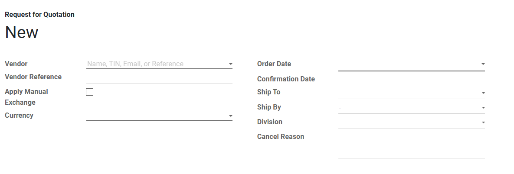

#  Alur Pembuatan Invoices

Halaman ini menjelaskan langkah-langkah standar untuk membuat dokumen *Invoice* (Pembelian Barang) hingga menjadi *RI* yang siap diproses oleh tim warehouse.

## 1. Membuat Invoice Baru

1. Masuk ke modul **Accounting** > **Customer** > **Invoices**.
2. Klik tombol **Create** di pojok kiri atas halaman. Atau pilih *Invoice* yang  sudah terbentuk dari *DO/RI*.
3. Pilih nama customer pada kolom **Partner**, isi alamat pengiriman pada kolom **Delivery Address**, dan pilih **Type Customer**.
4. Pilih termin pembayaran pada kolom **Payment Terms**. 
5. Pilih nama sales yang menjual produk tersebut pada kolom **Sales Person**. Sistem akan otomatis menarik *Region, *Area*, *District*, dan *Regency/City*.
6. Jika ada pembayaran sebelumnya menggunaka DP maka ceklis pada kolom *Is DP* dan isi nomor pembayaran invoice sebelumnya pada kolom *DP Invoice*. Sistem akan otomatis menarik nilai DP tersebut pada kolom **DP Amount**.
7. Pilih nilai tukar pembayaran (mata uang) ke vendor pada kolom **Currency**.
8. Pilih nomor SO untuk invoice tersebut pada kolom **Number SO**.

<em>Gambar 1 : Tampilan pengisian form pada purchase order.</em>

---

## 2. Pengisian Produk Pada Invoice

Pada tab **Invoice Lines**, masukkan produk yang akan diterbitkan invoice :

1. Klik **Add a line**.
2. Pilih **Product** dari daftar *dropdown*, sistem akan otomatis menarik **Description**, **Program**, **Faskes**, **Sale Program** dan **Discount xx+xx (%)** produk.
3. Pilih **Analytic Account** dan **Analytic Tags**.
4. Masukkan jumlah produk yang akan dibeli pada kolom **Quantity** dan isi harga yang dijual pada kolom **Price**.
5. Pilih satuan peoduk pada kolom **Unit of Measure**.
6. Sistem akan otomatis menarik jumlah **Subtotal**.
7. Isi keterangan pada *Terms and conditions* jika diperlukan terkait keterangan untuk pembayaran produk tersebut.
8. Jika ada diskon pilih tipe diskon nya pada kolom **Global Discount Type** dan isi nilainya pada kolom **Discount Rate**.
9. Apabila ada diskon tambahan lagi pilih tipe diskon pada kolom **Cash Discount Type** dan isi nilainya pada kolom **Cash/Extra Disc Amount**.

<em>Gambar 2 : Tampilan pengisian produk pada tab Products.</em>

---

## 3. Pengisian Pajak Diskon 

Pada tab **Discount Tax**, masukkan informasi mengenai pajak yang diberikan pada invoice tersebut.

1. Pilih pajak diskon pada kolom **Add Disc Taxes**.
2. Pilih pajak diskon detail pada kolom **Add Disc Taxes Detail**.

<em>Gambar 3 : Tampilan pengisian informasi pembelian pada tab other information.</em>

---

## 4. Pengisian E-Invoicing

Pada tab **E-Invoicing Invoice Line**, masukkan informasi mengenai elektronik invoice jika ada (lewati langkah ini jika tidak ada).

1. Isi kode dokumen elektroniknya pada kolom **Supporting Document Code**.
2. Klik **Add a line**.
3. Pilih **Product** dari daftar *dropdown*. 
4. Isi deskripsi produk pada kolom **Description**.
5. Isi jumlah produk yang tertera pada invoice pada kolom **Quantity**.
6. Pilih satuan peoduk pada kolom **Unit of Measure**.
7. Isi **Price**, **Discount**, **DPP**, **Tax Amount**, dan **Total**. 
8. Jika full diskon ceklis pada kolom **Full Discount**, dan jika diluar pajak ny klik pada kolom **Excluded**.

<em>Gambar 3 : Tampilan pengisian informasi pembelian pada tab other information.</em>

---

## 5. Pengisian Informasi

Pada tab **Other Info**, masukkan informasi mengenai informasi terkait invoice tersebut.

1. Sistem secara otomatis telah mnegisi **Journal**, **Account**, **Source Document**, dan juga *List* pajak yang sudah dipilih.
2. Pilih referensi pwmbayaran pada kolom **Payment Ref.**, dan isi deskripsinya pada kolom **Reference/Description**.
3. Jika transaksi ini merupakan transaksi dengan negara lain maka isi ketentuan nya pada kolom **Incoterm** dan **Fiscal Position**.
4. Masukkan kode akun bank pada kolom **Bank Account**.

<em>Gambar 3 : Tampilan pengisian informasi pembelian pada tab other information.</em>

---

## 6. Pengisian E-Invoicing

Pada tab **E-Invoicing**, masukkan informasi mengenai elektronik invoice.

1. Ceklis apabila e-invoicing akan di export pada kolom **Is E-Invoicing Exported**.
2. Isi tanggal export'an e-invoiceing tersebut pada kolom **E-Invoicing Exported Date**.

<em>Gambar 3 : Tampilan pengisian informasi pembelian pada tab other information.</em>

---

## 7. Pengisian Commission

Pada tab **Commission**, Sistem akan otomatis mengisi pada tab komisi ini ketika state sudah berpindah dari *Draft* ke *Open*.

<em>Gambar 3 : Tampilan pengisian informasi pembelian pada tab other information.</em>

---

## 8. Pengisian Return Commission

Pada tab **Return Commission**, masukkan informasi mengenai pengembalian komisi pada invoice tersebut.

1. Pilih pajak diskon pada kolom **Add Disc Taxes**.
2. Pilih pajak diskon detail pada kolom **Add Disc Taxes Detail**.

<em>Gambar 3 : Tampilan pengisian informasi pembelian pada tab other information.</em>

---

## 9. Pengisian Duedate Installment

Pada tab **Duedate Installment**, masukkan informasi mengenai tanggal cicilan pada invoice tersebut.

1. Pilih detail ke berapa pada kolom **Add Installments**.
2. Pilih tanggal cicilan tersebut pada kolom **Date**.

<em>Gambar 3 : Tampilan pengisian informasi pembelian pada tab other information.</em>

---

## 10. Pengisian Picking References 

Pada tab **Picking References**, masukkan informasi mengenai pajak yang diberikan pada invoice tersebut.

1. Pilih pajak diskon pada kolom **Add Disc Taxes**.
2. Pilih pajak diskon detail pada kolom **Add Disc Taxes Detail**.

<em>Gambar 3 : Tampilan pengisian informasi pembelian pada tab other information.</em>

---

## 11. Pengisian Print Layout

Pada tab **Print Layout**, masukkan informasi mengenai pajak yang diberikan pada invoice tersebut.

1. Pilih pajak diskon pada kolom **Add Disc Taxes**.
2. Pilih pajak diskon detail pada kolom **Add Disc Taxes Detail**.

<em>Gambar 3 : Tampilan pengisian informasi pembelian pada tab other information.</em>

---

## 12. Pengisian Negotiation

Pada tab **Negotiation**, masukkan informasi mengenai pajak yang diberikan pada invoice tersebut.

1. Pilih pajak diskon pada kolom **Add Disc Taxes**.
2. Pilih pajak diskon detail pada kolom **Add Disc Taxes Detail**.

<em>Gambar 3 : Tampilan pengisian informasi pembelian pada tab other information.</em>

---

## 13. Pengisian Negotiation New 

Pada tab **Negotiation New**, masukkan informasi mengenai pajak yang diberikan pada invoice tersebut.

1. Pilih pajak diskon pada kolom **Add Disc Taxes**.
2. Pilih pajak diskon detail pada kolom **Add Disc Taxes Detail**.

<em>Gambar 3 : Tampilan pengisian informasi pembelian pada tab other information.</em>

---

## 14. Menunggu Approval

Pada state *To Approved*, atasan akan mengecek pembelian produk tersebut, jika sudah sesuai dan menyetujui pembelian produk tersebut maka tekan tombol **Approve Order**.

## 📝 Referensi Tambahan

### SOP Harian (Checklist)
* <input type="checkbox"> **Memastikan Nama Vendor dan Currency** sudah sesuai dan benar.
* <input type="checkbox"> **Memastikan Produk, Quantity serta Diskon** sudah sesuai dengan kebutuhan pembeli.
* <input type="checkbox"> **Pastikan Deliver To** sudah sesuai dan benar.

### Fitur Berdasarkan Hak Akses
=== "User"
    - Dapat membuat *PR* baru dan dapat melihat keseluruhan data pada modul.

=== "Manager"
    - Dapat membuat *PR* baru dan dapat melihat keseluruhan data pada modul.
    - Dapat melihat tampilan menu *Analisa Harga Beli* dan *Reporting*.

=== "Approver"
    - Dapat membuat *PR* baru dan dapat melihat keseluruhan data pada modul.
    - Dapat melakukan action *Approve Order* jika permintaan sudah sesuai.

??? info "What Next?"
    Setelah *PO* sudah dilakukan *Approve Order* selanjutnya dokumen akan masuk ke Modul *RI*.
    [Lanjut ke Modul Sales:octicons-arrow-right-16:](../dept_who/inventory_ri.md)