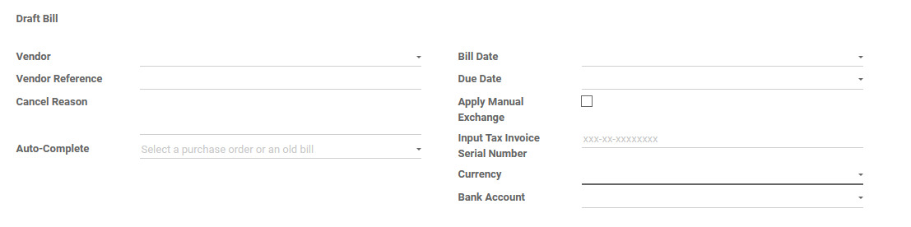
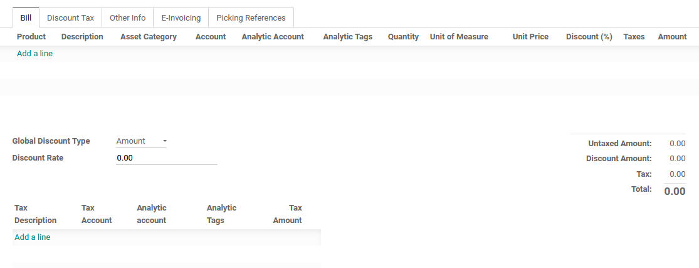
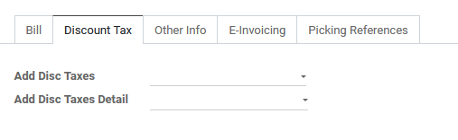
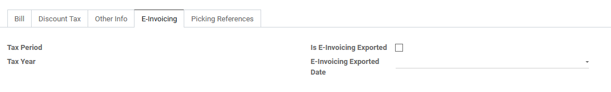
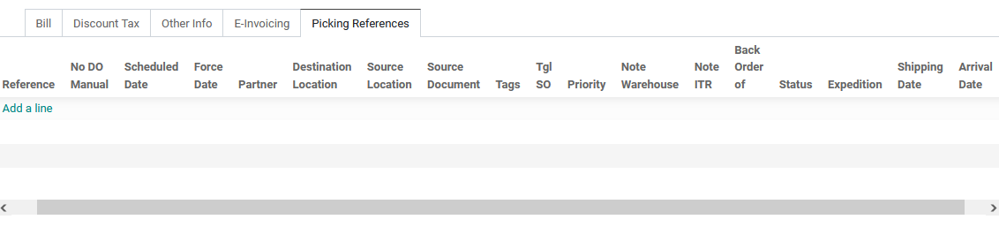

    
#  Alur Pembuatan Vendor Bill

Halaman ini menjelaskan langkah-langkah standar untuk membuat dokumen *Vendor Bill* (Pembayaran) hingga menjadi *Payment* yang siap diproses oleh tim kasir.

## 1. Membuat Vendor Bill Baru

1. Masuk ke modul **Purchase** > **Control** > **Vendor Bills**.
2. Klik tombol **Create** di pojok kiri atas halaman. Atau pilih *Vendor Bill* yang  sudah terbentuk dari *PO*.
3. Pilih nama vendor pada kolom **Vendor**, isi referensi keteranga vendor pada kolom **Vendor Reference**.
4. Isi nomor PO pada kolom **Source Document**. 
5. Isi tanggal pembayaran pada kolom **Bill Date**. Sistem akan otomatis menarik *Due Date*.
6. Masukkan nomor pajak invoice pada kolom **Input Tax Invoice Serial Number**.
7. Pilih nilai tukar pembayaran (mata uang) ke vendor pada kolom **Currency**.

<em>Gambar 1 : Tampilan pengisian form pada invoices.</em>

---

## 2. Pengisian Produk Pada Bill

Pada tab **Bill**, masukkan produk yang akan dibayarkan :

1. Klik **Add a line**.
2. Pilih **Product** dari daftar *dropdown*, sistem akan otomatis menarik **Description**.
3. Jika merupakan pembelian asset maka pilih kategori asset pada kolom **Asset Category**.
3. Pilih **Analytic Account** dan **Analytic Tags**.
4. Masukkan jumlah produk yang akan dibeli pada kolom **Quantity** dan isi harga beli pada kolom **Unit Price**.
5. Pilih satuan produk pada kolom **Unit of Measure**.
6. Pilih pajak pembelian tersebut pada kolom **Taxes**.
7. Sistem akan otomatis menarik jumlah **Amount**.
8. Jika ada diskon pilih tipe diskon nya pada kolom **Global Discount Type** dan isi nilainya pada kolom **Discount Rate**.
9. Apabila ada pajak maka masukkan pada kolom pajak **Tax Description**, masukkan kode akun pajaknya pada kolom **Tax Account**, Pilih **Analytic Account** dan **Analytic Tags**, dan masukkan nilai pajak nya pada kolom **Tax Amount**.
10. Masukkan keterangan untuk bill tersebut jika ada pada kolom **Additional notes**.

<em>Gambar 2 : Tampilan pengisian produk pada tab Products.</em>

---

## 3. Pengisian Pajak Diskon 

Pada tab **Discount Tax**, masukkan informasi mengenai pajak yang diberikan pada invoice tersebut.

1. Pilih pajak diskon pada kolom **Add Disc Taxes**.
2. Pilih pajak diskon detail pada kolom **Add Disc Taxes Detail**.

<em>Gambar 3 : Tampilan pengisian pajak pada tab discount tax.</em>

---

## 4. Pengisian Informasi

Pada tab **Other Info**, masukkan informasi mengenai informasi terkait invoice tersebut.

1. Pilih user yang mengajukan pembelian produk tersebut pada kolom **Purchase Representative**.
2. Pilih jurnal bill tersebut pada kolom **Journal**.
3. Masukkan nomor akun untuk bill tersebut pada kolom **Account**.
4. Pilih tanggal untuk dimasukkan ke dalam invoice pada kolom **Accounting Date**.
5. Masukkan keterangan lainnya terkait bill tersebut pada kolom **Reference/Description**.
6. Pilih ketentuan yang ditetapkan vendor luar negeri jika ada pada kolom **Incoterm** dan **Fiscal Position**.
7. Pilih tipe pembayaran yang akan dilakukan pada kolom **Payment Terms**.

<em>Gambar 5 : Tampilan pengisian informasi invoice pada tab other info.</em>

---

## 5. Pengisian E-Invoicing

Pada tab **E-Invoicing**, masukkan informasi mengenai elektronik invoice.

1. Ceklis apabila e-invoicing akan di export pada kolom **Is E-Invoicing Exported**.
2. Isi tanggal export'an e-invoiceing tersebut pada kolom **E-Invoicing Exported Date**.

<em>Gambar 6 : Tampilan pengisian informasi cetak e-invoicing pada tab e-invoicing.</em>

---

## 6. Pengisian Picking References 

Pada tab **Picking References**, masukkan informasi mengenai pengambilan barang di gudang dan status barang tersebut.

1. Klik **Add a line**.
2. Pilih nomor DO yang akan dimasukkan pada kolom **No DO Manual**.
3. Klik **Select**, maka akan tampil keterangan barang pada DO yang telah dipilih.

<em>Gambar 10 : Tampilan pengisian informasi status barang pada tab picking references.</em>

---

## 7. Menunggu Pembayaran

Finance akan melakukan validate pada vendor bill tersebut dan state akan berubah menjadi *Open*, akan dilakukan pembayaran invoice tersebut, dan apabila sudah dibayarkan sesuai nilai yang tertera maka state akan berubah menjadi *Paid*.

## 📝 Referensi Tambahan

### SOP Harian (Checklist)
* <input type="checkbox"> **Memastikan Nama Pelanggan** sudah sesuai dan benar.
* <input type="checkbox"> **Memastikan Produk, Quantity, Diskon, dan Tax** sudah sesuai dan benar.
* <input type="checkbox"> **Pastikan Nilai Amount dan Total** sudah sesuai dan benar.

### Fitur Berdasarkan Hak Akses
=== "Manager"
    - Dapat membuat *Invoice* baru dan dapat melihat keseluruhan data pada modul.
    - Dapat melihat tampilan menu *Analisa Harga Beli* dan *Reporting*.

=== "Approver"
    - Dapat membuat *PR* baru dan dapat melihat keseluruhan data pada modul.
    - Dapat melakukan action *Approve Order* jika permintaan sudah sesuai.

??? info "What Next?"
    Setelah *Invoice* sudah dilakukan *Validate* selanjutnya dokumen akan masuk ke Modul *Payment*.
    [Lanjut ke Modul Sales:octicons-arrow-right-16:](../dept_who/inventory_ri.md)