    
#  Alur Pembuatan Vendor Bill

Halaman ini menjelaskan langkah-langkah standar untuk membuat dokumen *Vendor Bill* (Pembayaran) hingga menjadi *Payment* yang siap diproses oleh tim kasir.

## 1. Membuat Vendor Bill Baru

1. Masuk ke modul **Purchase** > **Control** > **Vendor Bills**.
2. Klik tombol **Create** di pojok kiri atas halaman. Atau pilih *Vendor Bill* yang  sudah terbentuk dari *PO*.
3. Pilih nama vendor pada kolom **Vendor**, isi referensi keteranga vendor pada kolom **Vendor Reference**.
4. Pilih termin pembayaran pada kolom **Payment Terms**. 
5. Pilih nama sales yang menjual produk tersebut pada kolom **Sales Person**. Sistem akan otomatis menarik *Region, *Area*, *District*, dan *Regency/City*.
6. Jika ada pembayaran sebelumnya menggunaka DP maka ceklis pada kolom *Is DP* dan isi nomor pembayaran invoice sebelumnya pada kolom *DP Invoice*. Sistem akan otomatis menarik nilai DP tersebut pada kolom **DP Amount**.
7. Pilih nilai tukar pembayaran (mata uang) ke vendor pada kolom **Currency**.
8. Pilih nomor SO untuk invoice tersebut pada kolom **Number SO**.
9. Jika ada kondisi untuk pemberian komisi maka isi pada bagian *Commission Condition*. 

<em>Gambar 1 : Tampilan pengisian form pada invoices.</em>

---

## 2. Pengisian Produk Pada Invoice

Pada tab **Invoice Lines**, masukkan produk yang akan diterbitkan invoice :

1. Klik **Add a line**.
2. Pilih **Product** dari daftar *dropdown*, sistem akan otomatis menarik **Description**, **Program**, **Faskes**, **Sale Program** dan **Discount xx+xx (%)** produk.
3. Pilih **Analytic Account** dan **Analytic Tags**.
4. Masukkan jumlah produk yang akan dibeli pada kolom **Quantity** dan isi harga yang dijual pada kolom **Price**.
5. Pilih satuan peoduk pada kolom **Unit of Measure**.
6. Sistem akan otomatis menarik jumlah **Subtotal**.
7. Isi keterangan pada *Terms and conditions* jika diperlukan terkait keterangan untuk pembayaran produk tersebut.
8. Jika ada diskon pilih tipe diskon nya pada kolom **Global Discount Type** dan isi nilainya pada kolom **Discount Rate**.
9. Apabila ada diskon tambahan lagi pilih tipe diskon pada kolom **Cash Discount Type** dan isi nilainya pada kolom **Cash/Extra Disc Amount**.

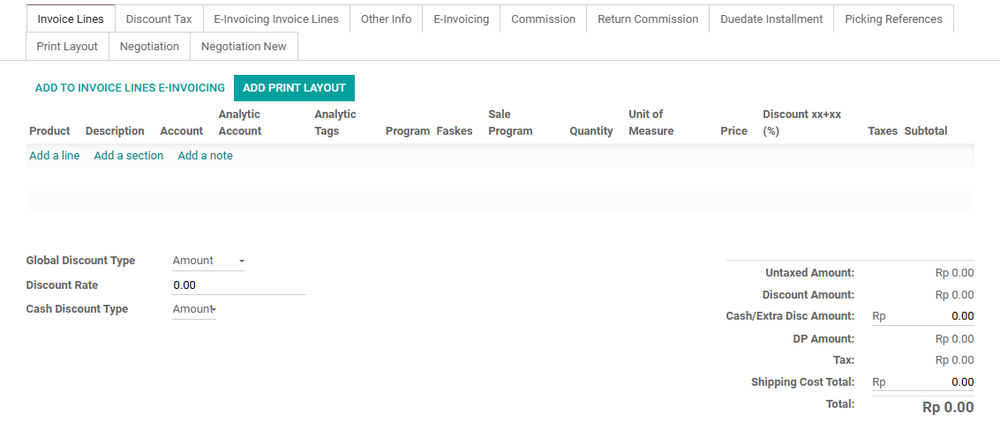

<em>Gambar 2 : Tampilan pengisian produk pada tab Products.</em>

---

## 3. Pengisian Pajak Diskon 

Pada tab **Discount Tax**, masukkan informasi mengenai pajak yang diberikan pada invoice tersebut.

1. Pilih pajak diskon pada kolom **Add Disc Taxes**.
2. Pilih pajak diskon detail pada kolom **Add Disc Taxes Detail**.

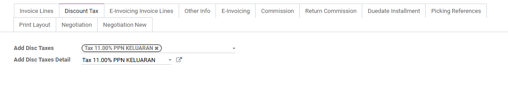

<em>Gambar 3 : Tampilan pengisian pajak pada tab discount tax.</em>

---

## 4. Pengisian E-Invoicing

Pada tab **E-Invoicing Invoice Line**, masukkan informasi mengenai elektronik invoice jika ada (lewati langkah ini jika tidak ada).

1. Isi kode dokumen elektroniknya pada kolom **Supporting Document Code**.
2. Klik **Add a line**.
3. Pilih **Product** dari daftar *dropdown*. 
4. Isi deskripsi produk pada kolom **Description**.
5. Isi jumlah produk yang tertera pada invoice pada kolom **Quantity**.
6. Pilih satuan peoduk pada kolom **Unit of Measure**.
7. Isi **Price**, **Discount**, **DPP**, **Tax Amount**, dan **Total**. 
8. Jika full diskon ceklis pada kolom **Full Discount**, dan jika diluar pajak ny klik pada kolom **Excluded**.

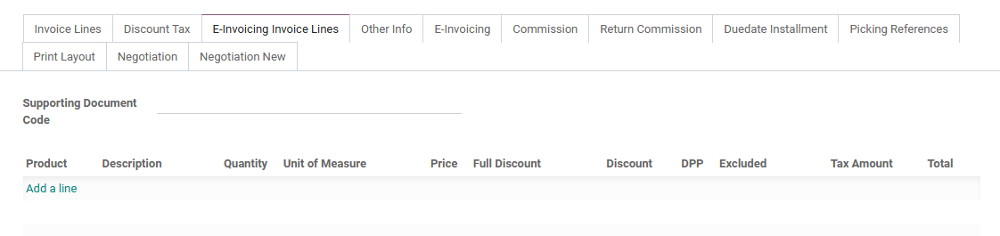

<em>Gambar 4 : Tampilan pengisian informasi e-invoicing pada tab e-invoicing invoice line.</em>

---

## 5. Pengisian Informasi

Pada tab **Other Info**, masukkan informasi mengenai informasi terkait invoice tersebut.

1. Sistem secara otomatis telah mnegisi **Journal**, **Account**, **Source Document**, dan juga *List* pajak yang sudah dipilih.
2. Pilih referensi pwmbayaran pada kolom **Payment Ref.**, dan isi deskripsinya pada kolom **Reference/Description**.
3. Jika transaksi ini merupakan transaksi dengan negara lain maka isi ketentuan nya pada kolom **Incoterm** dan **Fiscal Position**.
4. Masukkan kode akun bank pada kolom **Bank Account**.

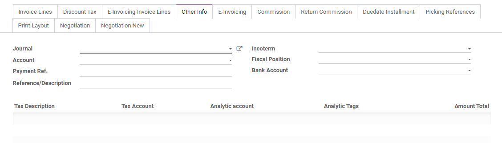

<em>Gambar 5 : Tampilan pengisian informasi invoice pada tab other info.</em>

---

## 6. Pengisian E-Invoicing

Pada tab **E-Invoicing**, masukkan informasi mengenai elektronik invoice.

1. Ceklis apabila e-invoicing akan di export pada kolom **Is E-Invoicing Exported**.
2. Isi tanggal export'an e-invoiceing tersebut pada kolom **E-Invoicing Exported Date**.

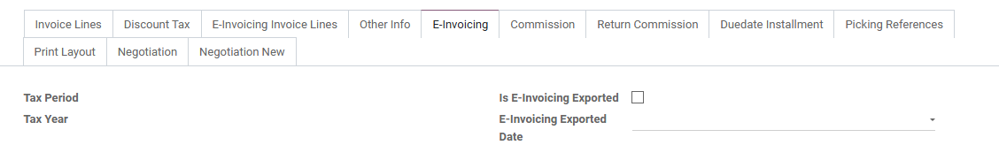

<em>Gambar 6 : Tampilan pengisian informasi cetak e-invoicing pada tab e-invoicing.</em>

---

## 7. Pengisian Commission

Pada tab **Commission**, Sistem akan otomatis mengisi pada tab komisi ini ketika state sudah berpindah dari *Draft* ke *Open*.

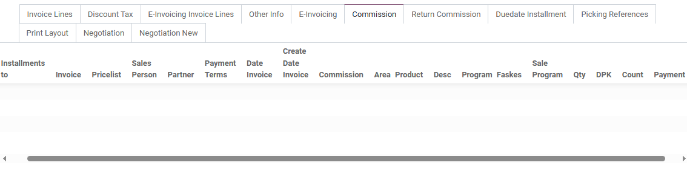

<em>Gambar 7 : Tampilan informasi komisi pada tab commission.</em>

---

## 8. Pengisian Return Commission

Pada tab **Return Commission**, masukkan informasi mengenai pengembalian komisi pada invoice tersebut.

1. Klik **Add a line**.
2. Pilih invoice yang akan dikembalikan komisinya pada kolom **Invoice**.
3. Sistem akan otomatis mengisi detail pada kolom yang ada untuk komisi yang sudah dipilih.

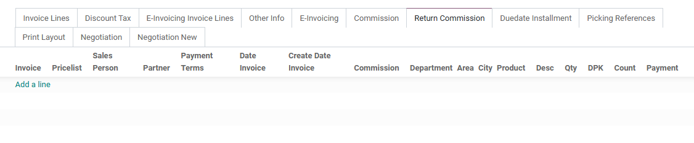

<em>Gambar 8 : Tampilan pengisian informasi pengembalian komisi pada tab return commission.</em>

---

## 9. Pengisian Duedate Installment

Pada tab **Duedate Installment**, masukkan informasi mengenai tanggal cicilan pada invoice tersebut.

1. Klik **Add a line**.
2. Pilih nomor cicilan ke berapa pada kolom **Installments**.
3. Isi tanggal cicilan tersebut pada kolom **Date**.

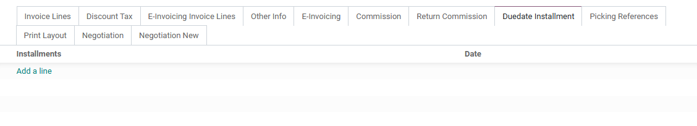

<em>Gambar 9 : Tampilan pengisian informasi cicilan pembayaran pada tab Duedate Installment.</em>

---

## 10. Pengisian Picking References 

Pada tab **Picking References**, masukkan informasi mengenai pengambilan barang di gudang dan status barang tersebut.

1. Klik **Add a line**.
2. Pilih nomor DO yang akan dimasukkan.
3. Klik **Select**, maka akan tampil keterangan barang pada DO yang terlah dipilih.

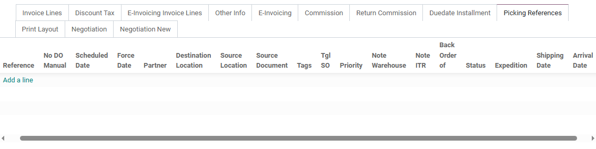

<em>Gambar 10 : Tampilan pengisian informasi status barang pada tab picking references.</em>

---

## 11. Pengisian Print Layout

Pada tab **Print Layout**, merupakan tampilan invoice yang akan di cetak dan bisa dicek terlebih dahulu nilai invoicenya apakah sudah sesuai sebelum dicetak.

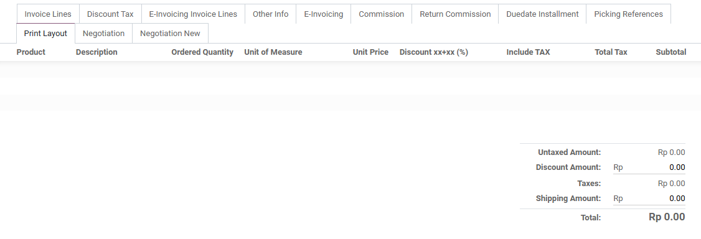

<em>Gambar 11 : Tampilan informasi nilai invoice yang akan dicetak pada tab print layout.</em>

---

## 12. Pengisian Negotiation

Pada tab **Negotiation**, merupakan informasi mengenai nilai COS yang tertera pada modul Negotiation Sheet lama sesuai dengan nomor transaksi yang akan di invoice kan.

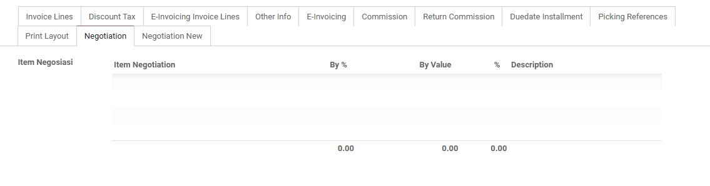

<em>Gambar 12 : Tampilan informasi cos negotiation lama pada tab negotiation.</em>

---

## 13. Pengisian Negotiation New 

Pada tab **Negotiation New**, merupakan informasi mengenai nilai COS yang tertera pada modul Negotiation Sheet baru sesuai dengan nomor transaksi yang akan di invoice kan.

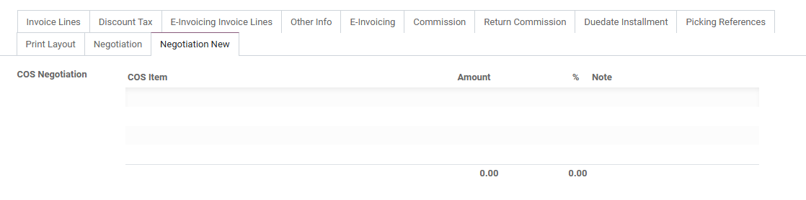

<em>Gambar 13 : Tampilan informasi cos negotiation baru pada tab negotiation baru.</em>

---

## 14. Menunggu Pembayaran

Pada state *Open*, akan dilakukan pembayaran invoice tersebut, dan apabila sudah dibayarkan sesuai nilai yang tertera maka state akan berubah menjadi *Paid*.

## 📝 Referensi Tambahan

### SOP Harian (Checklist)
* <input type="checkbox"> **Memastikan Nama Pelanggan** sudah sesuai dan benar.
* <input type="checkbox"> **Memastikan Produk, Quantity, Diskon, dan Tax** sudah sesuai dan benar.
* <input type="checkbox"> **Pastikan Nilai Amount dan Total** sudah sesuai dan benar.

### Fitur Berdasarkan Hak Akses
=== "Manager"
    - Dapat membuat *Invoice* baru dan dapat melihat keseluruhan data pada modul.
    - Dapat melihat tampilan menu *Analisa Harga Beli* dan *Reporting*.

=== "Approver"
    - Dapat membuat *PR* baru dan dapat melihat keseluruhan data pada modul.
    - Dapat melakukan action *Approve Order* jika permintaan sudah sesuai.

??? info "What Next?"
    Setelah *Invoice* sudah dilakukan *Validate* selanjutnya dokumen akan masuk ke Modul *Payment*.
    [Lanjut ke Modul Sales:octicons-arrow-right-16:](../dept_who/inventory_ri.md)