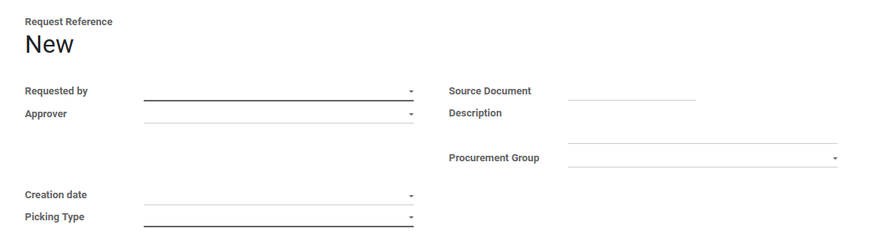

#  Alur Pembuatan Purchase Request

Halaman ini menjelaskan langkah-langkah standar untuk membuat dokumen *PR* (Permintaan Pembelian Barang) hingga menjadi *Purchase* yang siap diproses oleh tim purchase.

## 1. Membuat Permintaan Pembelian Produk Baru

1. Masuk ke modul **Purchase Requests**.
2. Klik tombol **Create** di pojok kiri atas halaman.
3. Isi data yang mengajukan permintaan pada kolom **Requested by**, dan yang akan menyetujui permintaan pada kolom **Approver**.
4. Pilih tipe pengambilan barang dari gudang mana pada kolom **Picking Type**.
5. Isi sumber dokumen **Source Document** dan alasan permintaan pengadaan produk **Description**.
6. Pilih sumber pengajuan pembelian produk dari nomor so berapa pada kolom **Procurement Group** jika ada.

<em>Gambar 1 : Tampilan pengisian form pada Purchase Request.</em>

---

## 2. Pengisian Produk

Pada tab **Products**, masukkan produk yang akan diajukan pembeliannya:

1. Klik **Add a line**.
2. Pilih **Product** dari daftar *dropdown*, sistem akan otomatis menarik **Description** produk.
3. Masukkan jumlah produk yang akan diajukan pada kolom **Quantity** dan pilih satuan yang diajukan.
4. Pilih departemen pada kolom **Analytic Account** dan isi tanggal pengajuan pembelian pada kolom **Request Date**.
5. Masukkan perkiraan harga pembelian produk jika ada pada kolom **Estimated Cost**.
6. Masukkan spesifikasi produk secara detail pada kolom **Specifications**.
7. Sistem akan otomatis mengisi *Tracking* mengenai pelacakan produk yang diajukan sudah sampai tahap apa.
8. Sistem juga akan otomatis menarik data pada tab *Purchase Order Lines* mengenai pelacakan produk PO tersebut.
9. Klik **Save & Close** jika produk yang diajukan hanya 1, apabila lebih dari 1 maka klik **Save & New** dan isi produk selanjutnya.
10. Kemudian klik **Save**.
11. Klik tombol **Request Approval** jika sudah tidak ada revisi pengajuan pembelian produk lagi, apabila sudah diklik maka sudah tidak bisa diubah lagi.

<em>Gambar 2.1 : Tampilan pengisian produk pada Products.</em>

<em>Gambar 2.2 : Tampilan pengisian produk untuk pembelian pada Products.</em>

---

## 3. Menunggu Approval

Pada state **To Be Approved**, maka yang menyetujui permintaan pembelian produk yaitu yang telah di set pada Field *Approver*. Setelah sudah di setujui maka akan terbentuk PO dan di dalam PR terdapat informasi PO untuk PR yang dibuat.

Kemudian jika vendor sudah melakukan pengiriman maka akan tampil data terkait pengiriman yaitu stock moves artinya perpindahan stok dari gudang vendor ke gudang perusahaan. Odoo akan menampilkan informasi terkait penerimaan barang dan penambahan stok barang pada gudang.

---

## 5. Melakukan Konfirmasi Pembuatan PO

Setelah dokumen PR disetujui, Anda harus membuat PO yang akan berstatus *RFQ*.

1. Klik **Button Lines**.
2. Kemudian ceklis *List Item* yang akan dibuatkan PO.
3. Pilih **Action**.
4. Klik **Create RFQ**.
5. Kemudian cek kembali apakah sudah benar dan sesuai PR yang akan diajukan, jika sudah klik button **Create RFQ**. Maka akan terbentuk nomor *PO*.

---

## 📝 Referensi Tambahan

### SOP Harian (Checklist)
* <input type="checkbox"> **Memastikan Produk dan Quantity yang akan diajukan** sudah sesuai dengan kebutuhan pembeli.
* <input type="checkbox"> **Memastikan spesifikasi yang akan diajukan** sudah lengkap dan sesuai dengan kebutuhan pembeli.
* <input type="checkbox"> **Pastikan ketika PR sudah disetujui sudah dibuatkan menjadi PO** sesuai dengan kesepakatan.

### Fitur Berdasarkan Hak Akses
=== "User"
    - Dapat membuat *PR* baru dan hanya dapat melihat data yang telah dibuat user pada modul.
    - Dapat melakukan action *Submit* jika permintaan sudah sesuai.
    - Dapat melakukan action *Create RFQ* jika sesuai selesai tahap Approval.

=== "Manager"
    - Dapat membuat *PR* baru dan dapat melihat keseluruhan data pada modul.
    - Dapat melakukan action *Approve* jika permintaan sudah sesuai.
    - Dapat melakukan action *Create RFQ* jika sesuai selesai tahap Approval.

??? info "What Next?"
    Setelah *PR* sudah dilakukan *Create RFQ* selanjutnya dokumen akan masuk ke Modul *Purchase*.
    [Lanjut ke Modul Sales:octicons-arrow-right-16:](../dept_prd/purchase_order.md)